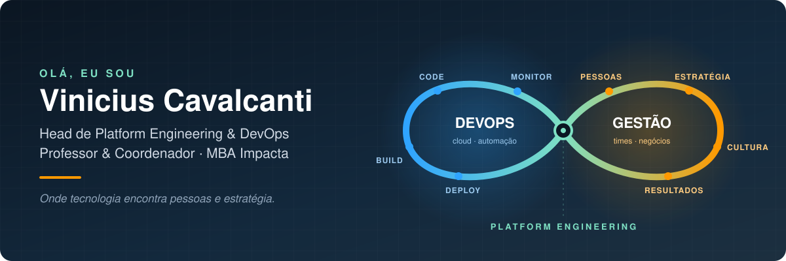
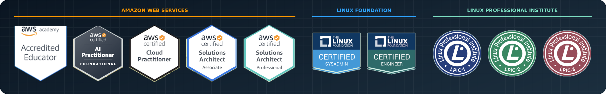

<p align="center">
  
</p>

<p align="center">
  <a href="https://www.linkedin.com/in/vinicius-cavalcantii/"></a>
  <a href="mailto:tux.cavalcanti@gmail.com"></a>
  <a href="https://mba.impacta.edu.br/mbas/cloud-computing-devops/"></a>
</p>

---

## 👋 Olá! Eu sou o Vinicius

Vivo **dois mundos que se alimentam**: de dia, construo plataformas que fazem times inteiros entregarem software com mais velocidade e segurança; à noite, levo essa experiência real para a sala de aula.

<table>
  <tr>
    <td width="50%" valign="top">
      <h3>🏢 No mercado</h3>
      <ul>
        <li><b>Head de Platform Engineering & DevOps</b></li>
        <li>Gestão de times e estratégia de plataforma</li>
        <li>Diversos projetos de Cloud, automação e cultura DevOps</li>
        <li>Transformo dor operacional em produto interno 🛠️</li>
      </ul>
    </td>
    <td width="50%" valign="top">
      <h3>🎓 Na academia</h3>
      <ul>
        <li><b>Professor e Coordenador</b> do <a href="https://mba.impacta.edu.br/mbas/cloud-computing-devops/">MBA de Cloud Computing & DevOps</a> da <b>Impacta</b></li>
        <li><b>AWS Academy Accredited Educator</b></li>
        <li>Ensino o que uso em produção, não só o que está no slide</li>
        <li>Formando a próxima geração de engenheiros de plataforma 🌱</li>
      </ul>
    </td>
  </tr>
</table>

```yaml
apiVersion: humano/v1
kind: PlatformEngineer
metadata:
  name: vinicius-cavalcanti
  labels:
    papel: head-platform-engineering-devops
    missao: ensinar-e-automatizar
spec:
  mercado: Head de Platform Engineering & DevOps
  academia: Professor & Coordenador · MBA Cloud Computing & DevOps · Impacta
  familia:
    esposa: Aline ❤️
    filho: Theodoro 👶
  replicas: 1            # não escala horizontalmente, mas é altamente disponível 😄
  restartPolicy: Always  # café ☕
```

---

## 🏅 Certificações

<p align="center">
  
</p>

<table align="center">
  <tr>
    <th>☁️ AWS</th>
    <th>🐧 Linux Foundation</th>
    <th>🐧 Linux Professional Institute</th>
  </tr>
  <tr>
    <td valign="top">
      <br/>
      <br/>
      <br/>
      <br/>
      
    </td>
    <td valign="top">
      <br/>
      
    </td>
    <td valign="top">
      <br/>
      <br/>
      
    </td>
  </tr>
</table>

---

## 🧰 Stack do dia a dia

<p align="center">
  
  
  
  
  
  
  <br/>
  
  
  
  
  
  
</p>

---

## 📚 Formação

<table>
  <tr>
    <td align="center" width="33%">💻<br/><b>Sistemas de Informação</b><br/><sub>Graduação</sub></td>
    <td align="center" width="33%">🤝<br/><b>Gestão de Pessoas</b><br/><sub>Pós-graduação</sub></td>
    <td align="center" width="33%">📈<br/><b>Gestão de Negócios</b><br/><sub>Fundação Dom Cabral · <i>cursando</i></sub></td>
  </tr>
</table>

<sub>Da base técnica à liderança: tecnologia para construir, gestão de pessoas para escalar times e visão de negócios para gerar impacto.</sub>

---

## 🏡 Fora do terminal

Pai do **Theodoro** e marido da **Aline**: é com eles que eu faço o *deploy* mais importante da semana. 💙
Acredito que bons engenheiros são, antes de tudo, boas pessoas, e que ensinar é a melhor forma de aprender de novo.
